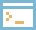
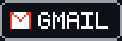

  

# Olá! 👋 Eu sou Alan Felipe

**Estudante de Análise e Desenvolvimento de Sistemas | Desenvolvedor Back-end em formação**

📍 Fortaleza, CE — Brasil

Sou estudante de Análise e Desenvolvimento de Sistemas e estou construindo minha jornada na área de desenvolvimento de software, com foco principal em **Back-end com Python**.

Tenho noções de desenvolvimento front-end com HTML, CSS e JavaScript, que me ajudam a compreender a construção de aplicações web de forma mais ampla. Atualmente, estou direcionando meus estudos para Python, lógica de programação, bancos de dados e desenvolvimento de APIs.

Meu objetivo é construir uma base sólida em desenvolvimento back-end, desenvolver projetos práticos e evoluir continuamente em programação, banco de dados, APIs e arquitetura de software, buscando oportunidades para crescer profissionalmente na área de tecnologia.

##  Projetos em destaque

### [python-estudos](https://github.com/alanfelipe01/python-estudos)
Repositório onde registro minhas atividades e a evolução dos meus estudos de Python. Ainda pequeno, mas vai crescer junto com os estudos.
`Python`

### [Portfolio-Web — Alan.exe](https://github.com/alanfelipe01/Portfolio-Web)
Meu portfólio pessoal, inspirado na interface do Windows 95 (janelas, ícones e taskbar), feito em HTML, CSS e JavaScript puros. Em evolução: é onde vou reunir meus projetos.
`HTML` `CSS` `JavaScript`

### [Litoranea Ambiental](https://github.com/alanfelipe01/litoranea-ambiental)
Landing page feita sob encomenda para uma empresa júnior da UFC, para divulgar os trabalhos ambientais deles. Meu primeiro projeto com cliente real.
`TypeScript` `React` `Tailwind CSS` `Lovable`

##  Tecnologias e ferramentas

  
  
  
  
  
  
  

##  GitHub

  
  

##  Contato

