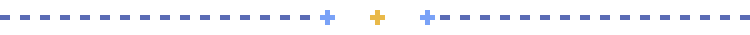
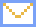
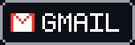

  

# Olá! 👋 Eu sou Alan Felipe

**Estudante de Análise e Desenvolvimento de Sistemas | Desenvolvedor Back-end em formação**

📍 Fortaleza, CE — Brasil

Sou estudante de Análise e Desenvolvimento de Sistemas e estou construindo minha jornada na área de desenvolvimento de software, com foco principal em **Back-end com Python**.

Tenho noções de desenvolvimento front-end com HTML, CSS e JavaScript, que me ajudam a compreender a construção de aplicações web de forma mais ampla. Atualmente, estou direcionando meus estudos para Python, lógica de programação, bancos de dados e desenvolvimento de APIs.

Meu objetivo é construir uma base sólida em desenvolvimento back-end, desenvolver projetos práticos e evoluir continuamente em programação, banco de dados, APIs e arquitetura de software, buscando oportunidades para crescer profissionalmente na área de tecnologia.

##  Projetos em destaque

### [tech-rent](https://github.com/alanfelipe01/tech-rent)
Sistema web para gerenciamento de aluguel e controle de equipamentos de Tecnologia da Informação.
`CSS` `HTML` `JavaScript`

### [sistema-estoque](https://github.com/alanfelipe01/sistema-estoque)
Descrição curta do que o sistema faz.
`HTML`

### [Portfolio-Web](https://github.com/alanfelipe01/Portfolio-Web)
Descrição curta do que o portfólio mostra.
`JavaScript`

##  Tecnologias e ferramentas

  
  
  
  
  
  
  

##  GitHub

  
  

##  Contato

