  

# Alan Felipe

**Desenvolvedor back-end em formação · Estudante de Análise e Desenvolvimento de Sistemas**

Fortaleza, CE — Brasil

[Portfólio](https://alan-felipe-portfolio.vercel.app) · [LinkedIn](https://www.linkedin.com/in/alan-felipe-dev) · [E-mail](mailto:alanfelipe1006@gmail.com)

---

## `$ whoami`

Sou estudante de ADS e estou construindo minha base em **desenvolvimento back-end com Python**. Uso este espaço para compartilhar projetos, praticar programação e registrar minha evolução.

Meus estudos se concentram em **Python, lógica de programação e bancos de dados**, com o objetivo de avançar na construção de APIs. Também tenho noções de HTML, CSS e JavaScript, que aplico em projetos web.

## `$ ls projetos/`

### [python-estudos](https://github.com/alanfelipe01/python-estudos)

Exercícios, desafios e pequenos projetos organizados por assunto. Meu registro de prática em Python e lógica de programação, com revisão dos conteúdos e evolução gradual.

`Python` `Lógica de programação`

### [Portfolio-Web](https://github.com/alanfelipe01/Portfolio-Web)

Meu portfólio inspirado no Windows 95: uma área de trabalho com janelas interativas, menu Iniciar e barra de tarefas. Desenvolvido com HTML, CSS e JavaScript puro, com adaptações para celular.

`HTML` `CSS` `JavaScript`

[Visitar o portfólio ↗](https://alan-felipe-portfolio.vercel.app)

### [Litorânea Ambiental](https://github.com/alanfelipe01/litoranea-ambiental)

Landing page para a empresa júnior de Ciências Ambientais da UFC, com apresentação de serviços, equipe e contato. Meu primeiro projeto para um cliente real, desenvolvido com apoio do Lovable.

`React` `TypeScript` `Tailwind CSS` `Lovable`

[Visitar o site ↗](https://litoranea-ambiental-ufc.vercel.app/)

---

## `$ cat stack.txt`

**Foco de estudo**

  
  

**Base em desenvolvimento web**

  
  
  

**Versionamento**

  
  

## `$ git log --stat`

  
  

---

## `$ cat contato.txt`

Para conversar sobre projetos, aprendizado ou oportunidades na área de desenvolvimento:

  
  

