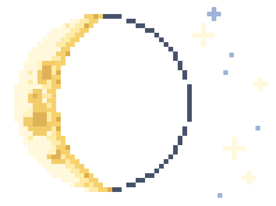

# Olá!, Eu sou Alan Felipe

**Estudante de Análise e Desenvolvimento de Sistemas | Desenvolvedor Back-end em formação**

📍 Fortaleza, CE — Brasil

Sou estudante de Análise e Desenvolvimento de Sistemas e estou construindo minha jornada na área de desenvolvimento de software, com foco principal em **Back-end com Python**.

Tenho noções de desenvolvimento front-end com HTML, CSS e JavaScript, que me ajudam a compreender a construção de aplicações web de forma mais ampla. Atualmente, estou direcionando meus estudos para Python, lógica de programação, bancos de dados e desenvolvimento de APIs.

Também venho aprendendo a utilizar ferramentas como Git e GitHub para versionar meus projetos, organizar meu código e acompanhar minha evolução como desenvolvedor.

Meu objetivo é construir uma base sólida em desenvolvimento back-end, desenvolver projetos práticos e evoluir continuamente em programação, banco de dados, APIs e arquitetura de software, buscando oportunidades para crescer profissionalmente na área de tecnologia.

## 🛠️ Tecnologias e ferramentas

  
  
  
  
  
  
  

---

<!--
## 🚀 Projetos em destaque

### 📌 Nome do projeto
Descrição curta do que o projeto faz.
[Ver projeto](link-do-projeto)

Quando tiver projeto pronto, tire os marcadores de comentário desta seção.
-->

## 📊 GitHub

  
  

---

## 🌐 Contato

  

  

---

