  

# Olá! 👋 Eu sou Alan Felipe

**Estudante de Análise e Desenvolvimento de Sistemas | Desenvolvedor Back-end em formação**

📍 Fortaleza, CE — Brasil

Sou estudante de Análise e Desenvolvimento de Sistemas e estou construindo minha trajetória em desenvolvimento de software, com foco em **back-end com Python**.

Tenho noções de HTML, CSS e JavaScript, que me ajudam a compreender o desenvolvimento de aplicações web de forma mais ampla. Atualmente, estou direcionando meus estudos para Python, lógica de programação, bancos de dados e desenvolvimento de APIs.

Busco consolidar esses conhecimentos em projetos práticos e me preparar para oportunidades profissionais na área de tecnologia.

##  Projetos em destaque

### [python-estudos](https://github.com/alanfelipe01/python-estudos)
Exercícios e atividades organizados por tema para praticar Python e lógica de programação, com registro da minha evolução nos estudos.
`Python`

### [Portfolio-Web — Alan.exe](https://github.com/alanfelipe01/Portfolio-Web)
Portfólio pessoal inspirado no Windows 95, com janelas, ícones e barra de tarefas. Desenvolvido com HTML, CSS e JavaScript puros para apresentar meus projetos em uma interface retrô.
`HTML` `CSS` `JavaScript`

### [Litorânea Ambiental](https://github.com/alanfelipe01/litoranea-ambiental)
Landing page criada sob encomenda para uma empresa júnior da UFC, com foco na apresentação de seus serviços ambientais. Meu primeiro projeto para um cliente real.
`TypeScript` `React` `Tailwind CSS` `Lovable`

##  Tecnologias e ferramentas

  
  
  
  
  
  
  

##  Estatísticas do GitHub

  
  

##  Contato

